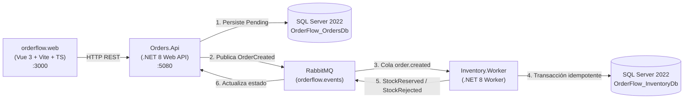

# OrderFlow — Sistema Distribuido de Pedidos e Inventario

Sistema full-stack orientado a eventos para la gestión de pedidos y reserva asíncrona de inventario, desarrollado en **.NET 8**, **SQL Server 2022**, **RabbitMQ**, **Vue 3 + TypeScript** y **Docker Compose**.

---

## 1. ¿De qué trata?

Una tienda en línea recibe pedidos desde un panel web operativo. Cada pedido se registra inicialmente en estado **`Pending`**, publica un evento `OrderCreated` en RabbitMQ y un worker independiente (`Inventory.Worker`) evalúa y descuenta el inventario disponible de manera transaccional e idempotente, respondiendo con `StockReserved` (`Confirmed`) o `StockRejected` (`Rejected`).

---

## 2. Arquitectura y Flujo



### Responsabilidades por proyecto
* **`Orders.Api`** *(ASP.NET Core 8 Web API)*: Valida peticiones REST, guarda pedidos en `Pending`, publica `OrderCreated` y ejecuta un `BackgroundService` (`InventoryEventsConsumer`) para actualizar estados a `Confirmed` o `Rejected`.
* **`Inventory.Worker`** *(.NET 8 Worker Service)*: Consume `order.created`, garantiza idempotencia y descuento atómico de stock, y publica `StockReserved` o `StockRejected`.
* **`OrderFlow.Contracts`** *(Class Library .NET 8)*: Contratos de eventos inmutables (`record`) y topología de RabbitMQ (`RabbitMqTopology`).
* **`orderflow.web`** *(Vue 3 + Vite + TypeScript)*: Panel operativo con formulario validado (errores visibles en pantalla), tabla paginada y *polling* automático cada 2 segundos.
* **`OrderFlow.Tests`** *(xUnit)*: Suite de 5 tests unitarios/integración sobre lógica crítica usando SQLite en memoria.

---

## 3. Estructura del repositorio

```text
├── OrderFlow.sln                 # Solución unificada de Visual Studio 2022
├── OrderFlow.Contracts/          # Contratos compartidos de eventos y constantes RabbitMQ
├── Orders.Api/                   # API REST + Consumidor de respuestas + Dockerfile
├── Inventory.Worker/             # Worker consumidor idempotente + Dockerfile
├── OrderFlow.Tests/              # 5 tests xUnit (validación, stock, idempotencia, estados)
├── orderflow.web/                # Frontend Vue 3 + TypeScript + Dockerfile (Nginx)
├── k8s/                          # Manifiestos Kubernetes (ConfigMap, Deployment, Service)
├── docker-compose.yml            # Orquestación completa de los 5 servicios
├── .env.example                  # Plantilla documentada de variables de entorno
└── .dockerignore / .gitignore
```

---

## 4. Cómo ejecutar el sistema

### Opción A — Ejecución completa con Docker Compose (Recomendado, < 5 min)

#### Requisitos previos
* **Docker Desktop** (con Docker Compose v2 activo).

#### Paso a paso
1. Clona el repositorio y entra a la carpeta raíz:
   ```bash
   git clone https://github.com/jogav514/OrderFlow.git
   cd OrderFlow
   ```
2. *(Opcional)* Si deseas personalizar puertos o contraseñas, copia `.env.example` a `.env`. Si no lo haces, `docker-compose.yml` usa valores de desarrollo por defecto para arrancar sin pasos manuales.
3. Construye y levanta los **5 contenedores**:
   ```bash
   docker compose up --build -d
   ```
4. Verifica que todos los servicios estén activos (`Up` / `healthy`):
   ```bash
   docker compose ps
   ```

#### Seed inicial automático
Al arrancar, `Orders.Api` e `Inventory.Worker` aplican automáticamente las migraciones de Entity Framework Core y cargan **4 productos iniciales** sin pasos manuales:

| SKU | Producto | Stock Inicial (`Disponible`) |
| :--- | :--- | :---: |
| `SKU-001` | Laptop Pro 14 | `10` |
| `SKU-002` | Monitor 27 4K | `5` |
| `SKU-003` | Teclado Mecánico | `20` |
| `SKU-004` | Mouse Inalámbrico | `0` *(para probar rechazo)* |

#### URLs disponibles
* **Panel Web (Frontend Vue 3):** http://localhost:3000
* **API & Swagger (`Orders.Api`):** http://localhost:5080/swagger
* **RabbitMQ Management UI:** http://localhost:15672 *(usuario: `orderflow` / contraseña: `OrderFlow_Rmq_2026!`)*

#### Comandos operativos útiles en Docker
* Ver logs en tiempo real: `docker compose logs -f orders-api` o `docker compose logs -f inventory-worker`
* Detener todo manteniendo datos: `docker compose down`
* Reiniciar desde cero borrando base de datos y colas: `docker compose down -v && docker compose up --build -d`

---

### Opción B — Ejecución en desarrollo local (Visual Studio 2022 / Consola)

#### Requisitos previos
* **.NET 8 SDK**, **Node.js 22+**, **Docker Desktop** (solo para SQL Server y RabbitMQ).

#### Paso a paso
1. Levanta únicamente la infraestructura base (SQL Server en puerto `14335` y RabbitMQ en `5672`/`15672`):
   ```bash
   docker compose up -d sqlserver rabbitmq
   ```
2. Ejecuta cada servicio pasando las variables de entorno en PowerShell (o configúralas en **User Secrets** para depurar con `F5` en Visual Studio 2022):
   * **Terminal 1 — `Orders.Api`:**
     ```powershell
     $env:ConnectionStrings__DefaultConnection="Server=127.0.0.1,14335;Database=OrderFlow_OrdersDb;User Id=sa;Password=OrderFlow_Dev_2026!;Encrypt=False;TrustServerCertificate=True;"; $env:RabbitMq__Host="localhost"; $env:RabbitMq__Port="5672"; $env:RabbitMq__UserName="orderflow"; $env:RabbitMq__Password="OrderFlow_Rmq_2026!"; dotnet run --project Orders.Api
     ```
   * **Terminal 2 — `Inventory.Worker`:**
     ```powershell
     $env:ConnectionStrings__DefaultConnection="Server=127.0.0.1,14335;Database=OrderFlow_InventoryDb;User Id=sa;Password=OrderFlow_Dev_2026!;Encrypt=False;TrustServerCertificate=True;"; $env:RabbitMq__Host="localhost"; $env:RabbitMq__Port="5672"; $env:RabbitMq__UserName="orderflow"; $env:RabbitMq__Password="OrderFlow_Rmq_2026!"; dotnet run --project Inventory.Worker
     ```
   * **Terminal 3 — `orderflow.web`:**
     ```powershell
     npm --prefix orderflow.web install
     npm --prefix orderflow.web run dev
     ```

---

## 5. Guía de pruebas manuales (Escenarios E2E)

Con el sistema corriendo en http://localhost:3000:

1. **Pedido válido (`Pending → Confirmed`):** Crea un pedido con cliente `"Ana Torres"`, SKU `SKU-001`, cantidad `2`. Nace en `Pending` y en ~2 segundos pasa a **`Confirmed`**.
2. **Stock insuficiente (`Pending → Rejected`):** Crea un pedido con SKU `SKU-004` (stock `0`) o pide más unidades de las disponibles. Cambia automáticamente a **`Rejected`** mostrando el motivo en pantalla.
3. **Validación de datos inválidos (`400 Bad Request`):** Deja el nombre vacío, pon cantidad `0` o `150`, o escribe un SKU inexistente (`SKU-999`). El error aparece directamente en el formulario.
4. **Resiliencia ante caída de `Inventory.Worker`:**
   * Ejecuta `docker compose stop inventory-worker`.
   * Crea un pedido válido $\rightarrow$ queda en **`Pending`** y el evento permanece en la cola `order.created` en RabbitMQ.
   * Ejecuta `docker compose start inventory-worker` $\rightarrow$ el Worker procesa el mensaje retenido y el pedido pasa a **`Confirmed`** o **`Rejected`**.
5. **Resiliencia ante caída de RabbitMQ:**
   * Ejecuta `docker compose stop rabbitmq`.
   * Intenta crear un pedido $\rightarrow$ `Orders.Api` responde **`503 Service Unavailable`** con mensaje visible en pantalla.
   * Restaura con `docker compose start rabbitmq`.

---

## 6. Pruebas automatizadas (`xUnit`)

La suite en `OrderFlow.Tests` utiliza **SQLite en memoria** para ejecutar transacciones SQL reales sin depender de Docker ni contaminar la base de datos:

1. `OrdersControllerTests.CreateOrder_ShouldReturn400_WhenSkuDoesNotExist`
2. `InventoryProcessorTests.ProcessOrderCreated_ShouldReserveStock_WhenStockIsSufficient`
3. `InventoryProcessorTests.ProcessOrderCreated_ShouldReject_WhenStockIsInsufficient`
4. `InventoryProcessorTests.ProcessOrderCreated_ShouldBeIdempotent_WhenSameEventArrivesTwice`
5. `OrderStatusUpdaterTests.ApplyStockReserved_AndLateRejected_ShouldNotOverwriteConfirmedOrder`

Ejecutar todas las pruebas con un solo comando:

```bash
dotnet test
```

---

## 7. Endpoints, Contratos y Variables de Entorno

### Endpoints REST (`Orders.Api`)
* `POST /orders` → `201 Created` (`Pending`), `400 Bad Request` o `503 Service Unavailable`.
* `GET /orders` → Lista pedidos ordenados del más reciente al más antiguo.
* `GET /orders/{id}` → Detalle de un pedido (`200 OK` o `404 Not Found`).
* `GET /products` → Catálogo de SKUs iniciales.

### Eventos (`OrderFlow.Contracts`)
* `OrderCreatedEvent`: `{ eventId, orderId, sku, cantidad, ocurridoEn }`
* `StockReservedEvent`: `{ eventId, orderId, sku, cantidad, ocurridoEn }`
* `StockRejectedEvent`: `{ eventId, orderId, sku, cantidad, motivo, ocurridoEn }`

### Variables de entorno (`.env.example`)
Ninguna credencial está escrita en el código fuente. Compose inyecta `ConnectionStrings__DefaultConnection`, `RabbitMq__Host`, `RabbitMq__Port`, `RabbitMq__UserName`, `RabbitMq__Password` y `VITE_API_URL`.

---

## 8. Idempotencia, Concurrencia y Manejo de Fallos

* **Idempotencia transaccional:** `Inventory.Worker` verifica e inserta `EventId` en `ProcessedEvents` (`PK`) dentro de la **misma transacción ACID** en que descuenta el stock.
* **Control de concurrencia:** `ExecuteUpdateAsync` filtra `Where(s => s.Sku == sku && s.Disponible >= cantidad)` generando un `UPDATE` atómico en SQL Server, respaldado por `CHECK ([Disponible] >= 0)`.
* **Confirmación manual (`autoAck: false`):** Solo se envía `BasicAck` después de confirmar en SQL Server y publicar la respuesta; ante fallos técnicos se ejecuta `BasicNack(requeue: true)` para reintentar.
* **Errores transitorios de SQL Server:** Configurado `EnableRetryOnFailure(5)` y `ApplyMigrationsWithRetryAsync` al arranque.

---

## 9. Decisiones de arquitectura y trade-offs

* **Un contenedor SQL Server con 2 bases lógicas (`OrderFlow_OrdersDb` y `OrderFlow_InventoryDb`):** Ahorra ~2 GB de RAM en evaluación local manteniendo aislamiento estricto de `DbContext` y esquemas por servicio.
* **Publicación directa vs. *Transactional Outbox*:** Se optó por publicación directa con respuesta explícita `503` si RabbitMQ cae, manteniendo la solución proporcional a 6–8 horas sin infraestructura extra de polling.
* **`RabbitMQ.Client` directo vs. MassTransit:** Control total y transparente de topología, serialización y `Ack`/`Nack`.
* **Polling cada 2s vs. SignalR:** Cumple el refresco automático de forma simple y robusta detrás de Nginx.

---

## 10. Bonus: Kubernetes (`k8s/`)

Para preparar `Orders.Api` para un entorno productivo en orquestación, se diseñaron 3 manifiestos declarativos en la carpeta `k8s/`:

1. **`k8s/orders-api-configmap.yaml` (`ConfigMap`):** Centraliza la configuración no sensible del servicio (`ASPNETCORE_ENVIRONMENT`, `ASPNETCORE_URLS`, `RabbitMq__Host`, `RabbitMq__Port`) desacoplada de la imagen Docker.
2. **`k8s/orders-api-deployment.yaml` (`Deployment`):**
   * Configura **`replicas: 2`** para alta disponibilidad.
   * Define límites de recursos (**`requests`: 100m CPU / 128Mi RAM**, **`limits`: 500m CPU / 256Mi RAM**) para evitar que un pod sature el nodo.
   * Incorpora **`readinessProbe`** (espera a que `GET /products` responda `200 OK` antes de recibir tráfico) y **`livenessProbe`** (reinicia el pod si deja de responder).
   * Inyecta credenciales sensibles (`ConnectionStrings__DefaultConnection`, `RabbitMq__UserName`, `RabbitMq__Password`) desde un `Secret` (`orderflow-secrets`), nunca en texto plano.
3. **`k8s/orders-api-service.yaml` (`Service`):** Expone el nombre DNS interno `orders-api-service` (puerto `80 -> 8080`, `ClusterIP`) para balancear peticiones entre las réplicas.

**Cómo desplegaría el sistema completo en Kubernetes:**
1. Publicar las imágenes Docker de `orders-api`, `inventory-worker` y `frontend` en un registro (ACR / Docker Hub).
2. Crear previamente el `Secret` `orderflow-secrets` en el clúster con las credenciales reales de SQL Server y RabbitMQ.
3. Desplegar SQL Server (`StatefulSet` con `PersistentVolumeClaim`) y RabbitMQ, o utilizar servicios administrados.
4. Aplicar los manifiestos (`kubectl apply -f k8s/`) y exponer el frontend y la API mediante un `Ingress` con TLS.

---

